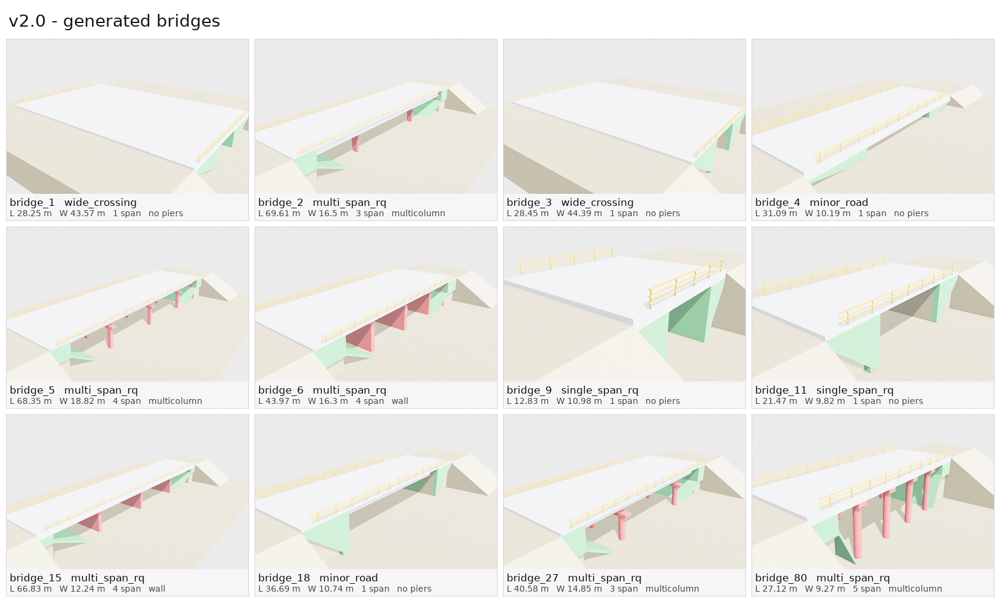
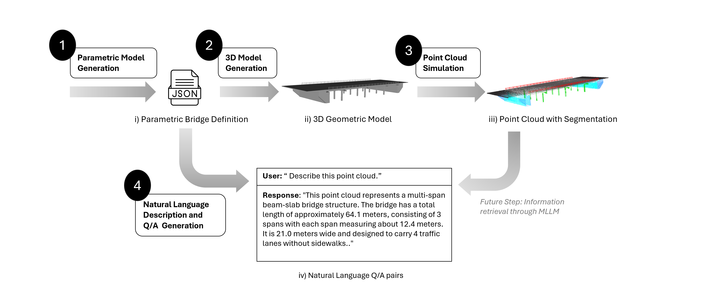

# Synthetic Bridge Dataset with Multi-Modal Data

A pipeline for generating synthetic bridge datasets with 3D models, simulated terrestrial laser scans (TLS) and text captions. It builds parametric bridge models with CadQuery, scans them from 8 positions with HELIOS++, and writes ML-ready point clouds and question-answer captions.

## About

Developed at the Chair of Computing in Civil and Building Engineering (Prof. Borrmann), Technical University of Munich.

Labelled point clouds of real bridges are scarce, and annotating them by hand is slow. This framework generates bridges with known geometry and pairs each scan with text, so it can be used to train and test models that read bridge point clouds, e.g. multimodal LLMs that describe a bridge or estimate its dimensions, and to check them against real scans.

Contact: salman.ahmed@tum.de

## Versions

| version | code | dataset | |
| --- | --- | --- | --- |
| **v2.0** | [`v2.0`](../../tree/v2.0) | [Hugging Face `v2.0/`](https://huggingface.co/datasets/SyedSalmanAhmed/MultiModalBridgeDataset/tree/v2.0) | new geometry fitted to real bridges |
| v1.0 | [`v1.0`](../../tree/v1.0) | [Hugging Face `Dataset1000bridges.zip`](https://huggingface.co/datasets/SyedSalmanAhmed/MultiModalBridgeDataset/tree/v1.0) | first release |

v2.0 data is not compatible with v1.0. Use the code tag that matches the dataset you downloaded. See [CHANGELOG.md](CHANGELOG.md).

## What's new in v2.0

v2.0 is the synthetic dataset used in *BridgePointLLM: Domain-specific Multimodal LLMs for Bridge Point Cloud Understanding* (submitted). For that work the generator was extended so that the synthetic bridges cover the configurations and dimensions seen in real scans, which v1.0 did not.



- Bridge shapes fitted to 32 measured real bridges, in four families
- Length sampled first, spans derived from it, end spans shorter than interior spans
- Widths from 2.8 m (footway) to 54 m (dual carriageway)
- Slab and girder decks
- Multicolumn and wall piers, cylindrical / rectangular / trapezoidal columns
- Wing wall abutments (single span) and spill-through abutments (multi span)
- Ground in the scene, so the scan sees the bridge like a real TLS scan does
- Templated captions

The real bridges are not part of this release. For access, contact salman.ahmed@tum.de.

## Pipeline



```
Parameter Generation (param_gen.py)
    ↓
Bridge Configuration (bridge_summary.json)
    ↓
3D Model Generation (CadQuery + bridge_model.py)
    ↓
HELIOS++ Simulation (8 scanner positions)
    ↓
Point Clouds (XYZ) → Segmentation → NPY (8192 x 6)
    ↓
Captions (text_captions_generation.py)
```

## Installation

```bash
conda env create -f environment.yml
conda activate cadq
```

## Quick Start

```bash
python main.py --num-bridges 1000 --seed 2026 --include-components --run-simulation --npy-conversion --npy-only --keep-meshes
python TextGeneration/text_captions_generation.py --template --source synthetic
```

| option | |
| --- | --- |
| `--num-bridges N` | number of bridges (required) |
| `--seed S` | random seed |
| `--bridge-type slab\|girder` | one deck type only (default: mixed) |
| `--include-components` | one OBJ per component |
| `--run-simulation` | run HELIOS++ |
| `--semantic-segmentation` | per-component XYZ |
| `--npy-conversion` | 8192 x 6 npy files |
| `--npy-only` | delete XYZ and meshes after npy |
| `--keep-meshes` | with `--npy-only`, keep the meshes |
| `--resume` | skip bridges that already have an npy |

## Dataset Structure

```
Dataset/
├─ bridge_summary.json          # all bridge parameters
├─ BridgeModels/
│  ├─ bridge_X.obj              # full bridge
│  └─ bridge_X/
│     ├─ deck.obj
│     ├─ railings.obj
│     ├─ piers.obj              # multi span only
│     ├─ abutments.obj
│     ├─ ground.obj             # scene only, not in the point cloud
│     └─ components.json
├─ PointCloudScans/
│  ├─ npy/bridge_X_8192.npy     # 8192 x 6 (xyz + 3 zero channels)
│  ├─ scales.json               # normalisation radius per bridge
│  └─ scanner_positions.json
└─ annotations/
   ├─ bridge_simple_descriptions.json
   └─ bridge_complex_instructions.json
```

## Scanner Setup

Each bridge is scanned from 8 positions. Heights are relative to the deck or the ground.

- **Legs 1-2**: on the deck, at each side
- **Legs 3-4**: on the approach road at each end
- **Legs 5-6**: below the deck, on the bank
- **Legs 7-8**: elevated, at each end

## Captions

Fixed questions and templated answers, no LLM:

```
The total length of the bridge is 54.0 meters.
The width of the bridge is 15.6 meters.
The bridge has 4 spans.
The piers are multicolumn piers.
```

## Acknowledgments

- **[CadQuery](https://github.com/CadQuery/cadquery)** - Parametric 3D CAD modeling in Python
- **[HELIOS++](https://github.com/3dgeo-heidelberg/helios)** - LiDAR simulation framework developed by 3DGeo Research Group, Heidelberg University

## Contact

For questions or collaboration:
- salman.ahmed@tum.de
- florian.noichl@tum.de

## License

[CC BY 4.0](https://creativecommons.org/licenses/by/4.0/)
